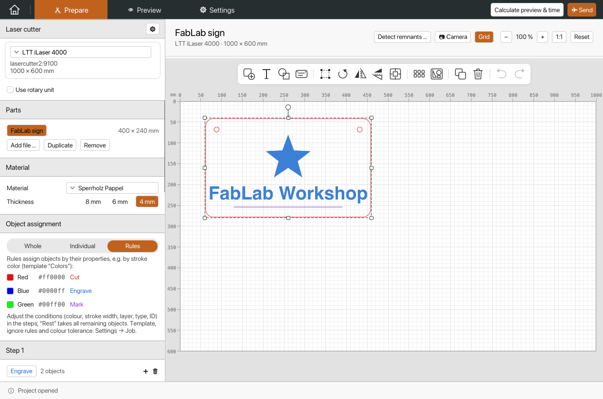
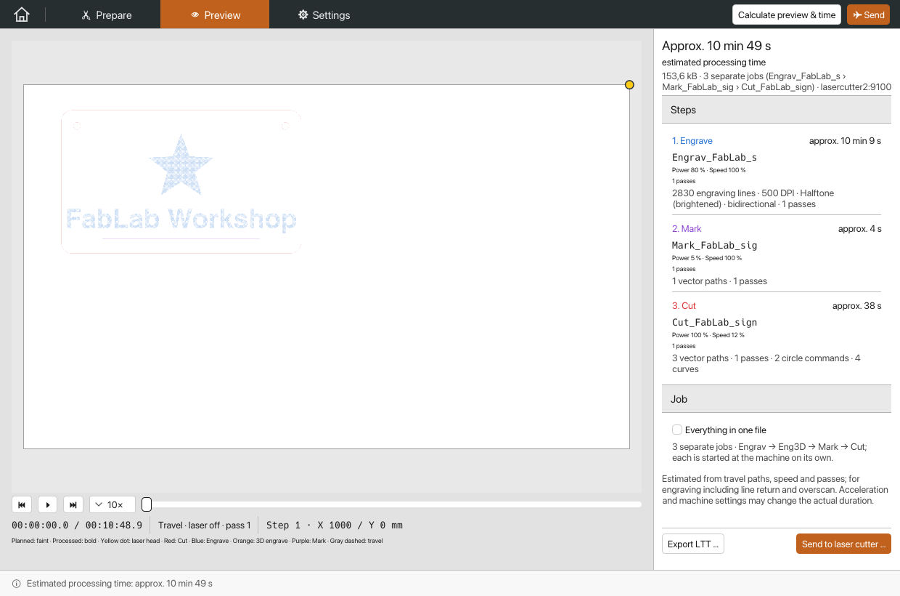
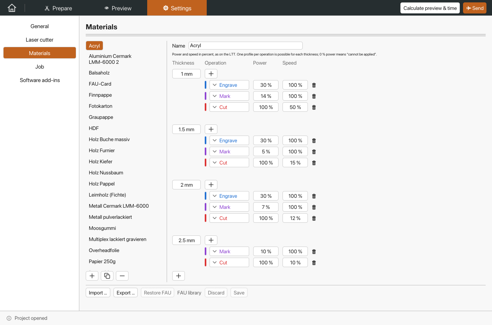

# VisiCutR

Prepare laser jobs from SVG, PDF, DXF, EPS, images, G-code, VisiCut projects
(PLF) and LaserScript, save `.vcr` projects, and export or send LTT jobs for
the FAU FabLab LTT iLaser 4000. VisiCutR is a Rust reimplementation of
[VisiCut](https://github.com/t-oster/VisiCut) by [dbambus](https://github.com/dbambus),
with the same egui interface on Windows, Linux and macOS. No Java is required.



| Job preview with time estimate | Material library |
| --- | --- |
|  |  |

## Downloads

Get the packages from [GitHub Releases](https://github.com/dbambus/VisiCutR/releases).
Versions with a suffix such as `1.0.0-rc.2` are prereleases.

| Platform | Package |
| --- | --- |
| Windows x64 | `VisiCutR-<version>-x86_64-pc-windows-msvc.zip` |
| Linux x64 (Ubuntu 24.04 or compatible) | `VisiCutR-<version>-x86_64-unknown-linux-gnu.tar.gz` |
| macOS Apple Silicon (macOS 14+) | `VisiCutR-<version>-aarch64-apple-darwin.zip` |

## Documentation

The documentation (in German) is in [`docs/`](docs/README.md): installation,
working with the application, Inkscape, Illustrator and CorelDRAW, the LTT
protocol, the byte comparison with Java VisiCut and development.
[CHANGELOG.md](CHANGELOG.md) lists the changes of every release.

## Build

Rust 1.90 is selected by `rust-toolchain.toml`.

```sh
cargo test --locked --all-targets
cargo run --release --bin visicutr
bash scripts/bundle-macos.sh   # macOS app in dist/VisiCutR.app
```

A push to `master` builds all three platforms and publishes a release when
the version in `Cargo.toml` has none yet; see [docs/Entwicklung.md](docs/Entwicklung.md).

## Java VisiCut

This repository is a fork of [t-oster/VisiCut](https://github.com/t-oster/VisiCut).
The Java source tree is no longer on `master`; the tag `java-reference` holds
the state the byte comparison was made with, and `scripts/java-parity/`
builds it on demand ([docs/Java-Vergleich.md](docs/Java-Vergleich.md)).

License: [LGPL v3 or later](COPYING.LESSER), with the accompanying [GPL v3](COPYING);
see [LICENSE](LICENSE).
